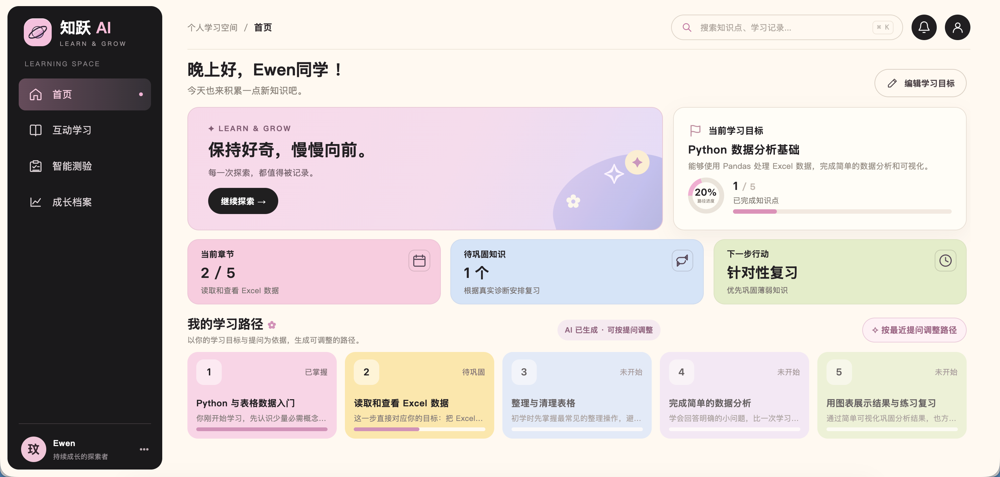
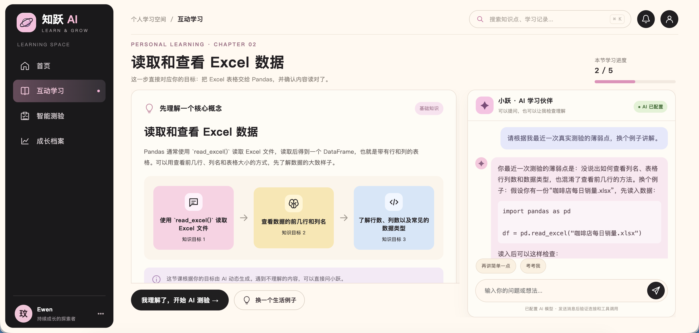
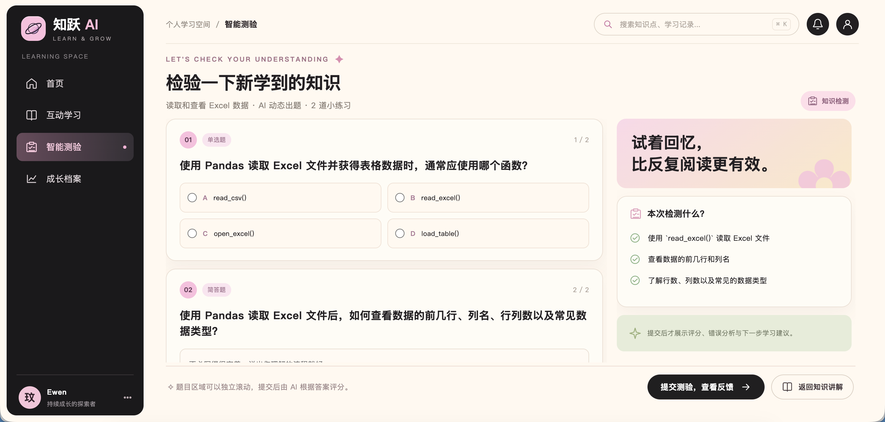
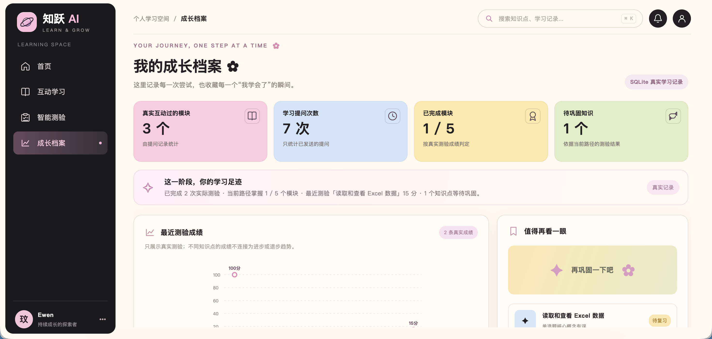

# 知跃 AI｜个性化学习 Agent

> 从学习目标出发，将 **AI 学习路径规划 → 互动辅导 → 智能测验 → 学习反馈 → 下一步行动** 串成可运行的学习闭环。

**项目类型：** C 端 AI 产品设计与开发实践 · 单用户本地 MVP  
**当前版本：** v1.7.3  
**技术栈：** Python · FastAPI · OpenAI Agents SDK · OpenAI-compatible API · SQLite · Pydantic · HTML/CSS/JavaScript

## 01｜项目概述

通用 AI 对话工具能够回答学习问题，但学习者仍需自行拆解目标、组织学习内容、判断掌握程度并规划下一步。知跃 AI 尝试把这些分散的动作整合到同一产品中，帮助学习者形成可追踪、可调整的个性化学习过程。

本项目同时覆盖**产品需求梳理、交互原型、AI 工作流设计、Agent 工具调用、前后端实现及本地测试**。目前为作品集展示用 MVP，不是已上线的商业服务。

### 核心流程

```text
输入学习主题、基础、目标与关注问题
        ↓
AI 生成 4–6 个递进知识模块 → SQLite 保存当前学习路径
        ↓
进入知识模块 → AI 辅导 Agent 读取课程内容与学习档案并多轮答疑
        ↓
针对当前模块生成 1 道单选题 + 1 道简答题
        ↓
客观题程序评分 + 简答题模型评分 → 形成反馈并记录真实成绩
        ↓
Agent 读取测验结果 → 建议继续学习或针对性复习
        ↓
用户确认后执行下一步 → 成长档案更新
```

## 02｜产品界面

以下是本地运行版本的界面截图。界面数据与 AI 在线连接状态以实际运行环境为准。

### 首页 · 学习目标与路径



### 互动学习 · AI 学习伙伴



### 智能测验 · 动态知识检测



### 成长档案 · 学习记录与待巩固内容



## 03｜核心功能与产品设计

| 模块 | 实现方式 | 设计目标 |
| --- | --- | --- |
| 个性化路径 | 结合主题、学习基础、目标及关注问题，由模型生成 4–6 个知识模块并写入 SQLite | 降低学习规划成本，避免所有用户套用固定课程 |
| 互动学习 | 单主辅导 Agent，支持课程内容查询、学习档案读取与用户授权的笔记记录 | 让回答结合当前知识点和实际学习上下文 |
| AI 智能测验 | 当前课程动态出题；单选题 40 分、简答题 60 分；返回评分维度及反馈 | 通过练习而不只是阅读来检验理解 |
| 学习决策 | Agent 读取真实测验与学习状态，提出「继续 / 复习」建议；用户确认后才变更相关状态 | 在自动化建议与用户控制之间取得平衡 |
| 成长档案 | 读取 SQLite 中的实际学习、测验、薄弱点和复习任务记录 | 将反馈沉淀为后续学习的依据 |

### AI Agent 与工具调用

互动辅导 Agent 通过 `openai-agents` 实现，调用后端工具读取实际信息：

- `get_learning_profile()`：获取学习目标、课程进度、测验与学习记录。
- `get_lesson_content()`：读取当前知识模块的内容和目标。
- `save_learning_note(note)`：仅在用户明确要求保存时写入学习笔记。

测验后的决策 Agent 还会通过 `get_latest_quiz_result()` 和 `get_learning_profile()` 查看最新记录。**Agent 只提出建议，不直接修改学习路径或创建复习任务**；相关更改由后端在用户确认后执行。

### 真实数据与异常处理

- 学习目标、生成路径、聊天记录、测验题目、评分结果和复习任务存于本地 SQLite。
- 测验提交前由后端核对题目 ID 和所属知识点；正确答案不随生成接口返回前端。
- AI 出题失败时显示错误及重试入口，**不将旧版示例题冒充新生成的题目**。
- 模型连接或评分失败时明确提示，不伪造测验成绩或历史学习数据。
- 模型产生的评分和建议属于辅助反馈，尚未经过大规模人工标注评测，不代表客观学习能力认证。

## 04｜技术架构

```text
浏览器（HTML / CSS / JavaScript）
                │ HTTP / JSON
                ▼
       FastAPI（app.py）
                │
       ┌────────┼────────┐
       ▼        ▼        ▼
  路径生成   Agent 辅导   出题 / 评分
       │        │        │
       │   Function Tools│
       │        │        │
       └────────┼────────┘
                ▼
        SQLite（db.py）
                ▲
         学习状态 / 历史记录
```

模型调用使用 OpenAI 兼容接口；辅导与学习决策使用 OpenAI Agents SDK，路径生成、测验出题及评分使用独立的结构化模型调用。前端为原生 HTML / CSS / JavaScript，并非 React 项目。

## 05｜本地运行

**环境要求：** Python 3.10+（推荐 3.11 / 3.12）及可用的模型 API Key。

```bash
# 1. 克隆仓库并进入目录
git clone https://github.com/Ewen-smile/zhiyue-ai-learning-agent.git
cd zhiyue-ai-learning-agent

# 2. 创建并启用虚拟环境
python3 -m venv .venv
source .venv/bin/activate
# Windows PowerShell：.venv\Scripts\Activate.ps1

# 3. 安装依赖
python -m pip install -r requirements.txt
```

通过终端环境变量配置模型，**不要将真实密钥写进代码或提交至 GitHub**：

```bash
export OPENAI_API_KEY="你的 API Key"
export OPENAI_MODEL="你有权限调用的模型名称"
# 使用第三方 OpenAI 兼容服务时设置：
# export OPENAI_BASE_URL="https://你的服务地址/v1"
export ZHIYUE_LLM_ADAPTER="agents_sdk"

python app.py
```

打开 **http://127.0.0.1:8000**，健康检查地址为 **http://127.0.0.1:8000/api/health**。

> **运行提示：** 未配置 API Key 时可以启动本地页面，但动态路径、出题与评分等真实 AI 功能不可用，不会假装成功。不同兼容接口对模型、工具调用或输出格式的支持可能不同；若出现 HTTP 502，请先检查 API 地址、密钥权限、模型可用性及服务状态。

## 06｜项目结构

```text
zhiyue-ai-learning-agent/
├── app.py                    # FastAPI API 与应用入口
├── agent.py                  # Agent、工具调用、路径生成、出题及评分
├── db.py                     # SQLite 数据表和状态管理
├── requirements.txt          # Python 依赖
├── .env.example              # 环境变量示例，不包含真实密钥
├── start_mac.command         # Mac 本地启动脚本
├── static/
│   ├── index.html            # 页面结构
│   ├── app-v1.7.1.js         # 交互与接口调用（保留历史文件名）
│   ├── app-v1.7.2-balanced.css # 页面样式（保留历史文件名）
│   └── planet-mark.svg       # 品牌图形
├── docs/                     # 四张产品页面截图
├── tests/                    # 本地测试
└── README.md
```

运行测试（需先安装 pytest）：

```bash
python -m pip install pytest
python -m pytest -q tests/
```

## 07｜当前边界与后续迭代

本项目当前是**单用户、本地运行的作品集 MVP**，未实现注册登录、权限隔离、多租户及生产级部署；不建议直接开放到公网。学习质量、模型成本、响应延迟和评分一致性仍需系统评测。后续可继续完善：基于人工标注样本的评分评测、更多学科的课程质量验证、学习路径效果实验以及部署与权限体系。

---

**项目定位：** AI 产品经理方向的产品设计 + Agent 工程实践。重点展示如何把 AI 能力嵌入完整用户流程，并在模型不确定性、真实数据、用户确认与产品体验之间做出取舍。
